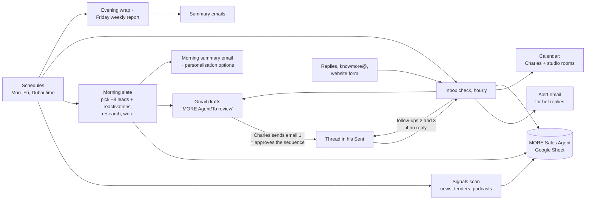

# 04 · Architecture: the lightweight build (decided 21 Oct)

## Design in one sentence

**Scheduled Claude sessions on Charles's existing Claude plan do the work, through the Google Workspace connections he already has** (Gmail, Calendar, Drive, Sheets):
- This repository holds the agent's instructions and settings.
- A Google Sheet in Charles's Drive is its memory.
- **Gmail drafts are the review queue.**

No servers, no database, no extra subscriptions.

## How it flows



## Components

| Part | What it is |
|---|---|
| **The brain** | Scheduled Claude sessions in the cloud, on Charles's Claude plan. Each run starts fresh, reads `CLAUDE.md`, its job file and the config in this repo, then works through the Google connectors. |
| **Memory** | A Google Sheet **"MORE Sales Agent"** in Charles's Drive, with tabs for Leads, Sequences, Signals, Suppression, Log and Settings. Charles can open it any time and see exactly what the agent knows and did. |
| **Review queue** | Drafts in Charles's Gmail labelled **MORE Agent/To review**. He edits if needed and presses send. **Sending email 1 approves that sequence.** |
| **Personalisation options** | Listed in the morning summary email (e.g. "Draft 3: use the Samsung mix instead of FoodTok? Reply 3B"). Charles replies with his picks; the next run updates the drafts. |
| **Alerts** | Short emails to Charles: morning summary, hot replies as they come in, evening wrap, Friday report |
| **Research** | Claude's built-in web search inside each run |
| **Contact finding** | The CRM, Charles's Gmail history, company websites and press. When no work address can be found, the lead becomes a "LinkedIn it" note for Charles. Optional later: MillionVerifier (~$5–10/month) to verify brand-new addresses. |
| **Calendars** | Charles's calendar for meeting slots. The studio room calendars (SoundStruck A and B, Flame, Breeze + Chime, Wave + Thunder, Stream) are used to answer studio requests with real availability. |
| **CRM sheet** | MORE – CRM is read for context and the collision check (never email someone a colleague is working). Write-back of Charles's own rows can be switched on after the first weeks. |

## Jobs and schedule (Dubai time, Monday to Friday)

| Job | When | What it does |
|---|---|---|
| **Signals scan** | 07:15 | Checks the sources in `config/sources.md` (agency news, tender alerts in Gmail, podcast charts, film-commission news, releases). New signals go to the Signals tab. |
| **Morning slate** | 07:45 | Builds the day's balanced slate: about 8 new leads across P1–P8 plus up to 5 reactivations. Researches each, writes the sequence, creates the email 1 drafts, updates the sheet, and sends the morning summary with any personalisation options. |
| **Inbox check** | Hourly, 09:00–18:00 | Classifies replies to agent threads and drafts responses. For meeting requests it proposes times from Charles's calendar. Opt-outs go to suppression. Incoming requests (knowmore@, website form) get draft replies, with room availability for studio requests. It applies Charles's picks from the summary, and notices first emails he has sent so their follow-ups get scheduled. **The 10:00 run also sends that day's due follow-ups.** |
| **Evening wrap** | 17:45 | What happened today, what's waiting for Charles, what's planned for tomorrow |
| **Weekly report** | Friday 11:45 | Results per play (sent, replies, meetings), what worked, suggested tweaks |

The runs count against Charles's Claude plan. If usage gets tight, the inbox check can drop to every two hours without changing anything else.

## What it does on its own, and what it never does

**On its own:**
- research and drafting
- keeping the sheet up to date
- reading replies
- proposing meeting times
- checking room availability
- sending summaries to Charles
- **follow-ups 2 and 3 inside a sequence Charles started, if the person hasn't replied**

**Never (by design):**
- send a first email
- quote a price
- email a personal address
- cold-email KSA
- automate LinkedIn or WhatsApp
- name a client that isn't on the website without Charles's pick
- contact someone a colleague is working with

## Compared with the full build

| | Lightweight (chosen) | Full build (not doing) |
|---|---|---|
| Extra cost | $0 (optional ~$5–10 for email verification) | ~$360–700/month |
| Review | Gmail drafts + summary emails | Web dashboard |
| Replies picked up | Within the hour | Within minutes |
| Robustness | A missed run catches up next hour | Durable workflows, retries |
| Scale | One sender, ~40 new contacts a week | Whole team |

If MORE later adds senders and outgrows this, the plays, rules, voice guide and sheet carry over to a full build unchanged.

## Repository layout

```
CLAUDE.md                  # operating manual every run reads first
agent/jobs/
  signals-scan.md
  morning-slate.md
  inbox-check.md
  evening-wrap.md
  weekly-report.md
config/
  plays.md                 # the 11 plays in run-ready form
  guardrails.md            # hard rules, caps, quiet hours, holidays, protected contacts
  proof.md                 # what may be named: website clients and projects
  voice-charles.md         # Charles's writing voice, learned from his sent mail
  sources.md               # where each play looks for signals
  sheet.md                 # the MORE Sales Agent sheet: tabs and columns
docs/                      # this plan
```

## Data and safety

- Everything runs under Charles's own Google account. Nothing is stored outside his Workspace and this private repository.
- No passwords or keys live in the repo.
- Every action is written to the Log tab.
- The Suppression tab is checked before every draft. Opt-outs are added the moment they're read and are never removed by the agent.
- Web pages, emails and replies are treated as information, never as instructions. An email that tries to instruct the agent is flagged to Charles instead.
