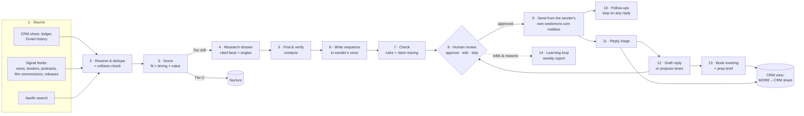

# 04 · Architecture: how the system is built

## Design in one sentence

**A code-controlled pipeline with Claude at the judgement steps**: scoring, research, writing, checking, reading replies. It is *not* a free-roaming autonomous agent. Every external action (send, book, update the CRM) goes through a guardrail layer and, until a play graduates, a human approval.

This keeps it predictable, auditable and cheap, and lets us raise autonomy play by play once the numbers justify it.

## The pipeline



| Stage | What happens | Claude's role |
|---|---|---|
| 1 Source | Collectors pull internal data and signals on schedules (hourly for news and tender emails, daily for podcasts and releases) | Signal classifier: "is this a buying signal, for which company and play, and how strong?" |
| 2 Resolve | Companies and people matched to existing records; suppression list, protected contacts and open conversations checked | — (deterministic) |
| 3 Score | Fit, timing and value against the play's rubric, giving Tier A/B/C | Scorer with structured output and a one-line reason |
| 4 Research | Company snapshot, the signal in context, relevant people, recent campaigns, which MORE receipts fit, 2–3 angle options. Every fact has a source URL. | Researcher using Claude's web search and web fetch tools plus internal lookups (CRM, past threads, proof library) |
| 5 Contacts | Buyer titles from the play, then the email waterfall and verification | — (APIs) |
| 6 Write | Email 1–4, LinkedIn note, WhatsApp text, in the sender's voice, using the play's template and the dossier | Writer |
| 7 Check | Hard rules (length, banned phrases, prices, NDA names, links, suppression) then a critic that traces every claim to the dossier. Fail → one rewrite → else flagged for a human. | Critic |
| 8 Review | Owner approves, edits or skips (with a reason) from their phone | — |
| 9–10 Send & follow up | Every email goes through the Gmail API from the sender's own wedomore.com mailbox and appears in their Sent folder like any email they write. The worker enforces per-sender daily caps, pacing, quiet hours and holidays. It also reads delivery-failure notices to catch bounces. | — |
| 11–12 Replies | Classified within minutes. Drafts prepared; times proposed from the owner's calendar. | Reply triage + responder |
| 13 Meetings | Invite (studio visit or Meet), confirmation, reminder, prep brief 2 hours before | Briefer |
| 14 Learn | Every edit and skip reason is stored. Weekly, Claude summarises patterns and *proposes* changes to templates and voice guides. A human approves them; nothing self-modifies silently. | Reporter |

## Components

| Component | Job |
|---|---|
| **Worker** | Runs every pipeline step as durable workflows. Multi-day sequences "sleep" for free between touches. Approval steps wait on a token the dashboard completes. Retries, rate limits and cron live here. |
| **Database** | The system of record: accounts, contacts, signals, dossiers, sequences, messages, replies, meetings, suppression, audit log |
| **Dashboard ("MORE Outbox")** | Mobile-first web app. Review queue with research beside each draft; inline edit; approve one or a batch. Also: pipeline, signals feed, tender radar, weekly report, and settings for plays, voices and guardrails. |
| **Notifications** | "3 drafts to review", "positive reply from X", "meeting booked", "new RFQ" sent to Charles **by email** (decided 21 Oct), with a deep link to the review queue. |
| **CRM sync** | Writes leads, stages, last/next interaction, thread links and notes into the **MORE – CRM** sheet, and reads back human edits to stage, owner and notes. The team keeps working where they already work. |
| **Gmail drafts mode** | For warm plays (P0), the agent drops ready-to-send drafts into the sender's own Gmail under a "MORE Agent" label. They review and hit send on their phone, with no new tool to learn. |

## The Claude layer

- **API surface:** the Claude Messages API from our own worker, using tool use for the researcher and responder, structured outputs for scoring and classification, and Claude's server-side web search and web fetch tools for research. This is the "code-controlled pipeline" tier, which suits a workflow like this better than a hosted autonomous agent.
- **Model:** **Claude Opus 5.5** (`claude-opus-5-5`) across the board to start. Effort is set per step: lower for classification, higher for research and writing. Once we have real usage data, you can decide whether cheaper models should take the high-volume classification steps. That's your call; we measure first.
- **Cost controls:**
  - Prompt caching on the long, stable parts (play configs, voice guides, guardrails, proof library).
  - The Batch API (about 50% cheaper) for overnight scoring and research that isn't time-critical.
  - Per-play monthly budget caps.
- **Quality controls:**
  - Small evaluation sets we build from real data and re-run whenever prompts change: reply classification (target ≥95% accuracy), claim tracing (zero untraceable claims), and draft approval rate.
  - Refusals and errors are handled explicitly and never silently dropped.

## Data model (first cut)

| Table | Key fields |
|---|---|
| `accounts` | name, domain, country, category, size, tags, crm_row_ref, owner |
| `contacts` | account, name, title, email, email_status, linkedin_url, phone (warm only), language, source, lawful_basis_note, do_not_contact |
| `signals` | account, play, type, headline, url, detected_at, strength, summary |
| `leads` | contact, play, tier, fit/timing/value scores and reason, stage, owner |
| `dossiers` | account, contact, facts (each with a source URL), angles, receipts chosen, model, created_at |
| `sequences` | lead, play, step, next_action_at, status (active, paused, stopped, done) |
| `messages` | sequence, channel, direction, subject, body, status (draft, approved, sent, bounced), mailbox, thread_id, approved_by, edit_diff, skip_reason |
| `replies` | message, classification, extracted fields (dates, referral, OOO return), next_action |
| `meetings` | lead, calendar_event_id, start, type (studio visit, Meet), status, prep_brief |
| `suppression` | email or domain (hashed), reason, date (permanent) |
| `audit_log` | every external action: who or what, when, payload hash |

Plays, voices, the proof library and guardrails live in version-controlled config files, not the database. Changing a play is reviewable like code.

## Integrations

| Integration | Use | Access needed |
|---|---|---|
| Gmail API | Read history (opt-in, read-only) for reactivation and voice; create drafts; send every approved email; watch for replies and bounces | Per-user OAuth consent (case study: Charles only), recommended over domain-wide delegation for least privilege. Access to knowmore@wedomore.com too, if incoming requests should be triaged from there. |
| Google Calendar API | Free/busy, create events with Meet links | Per-user OAuth |
| Google Sheets API | Two-way sync with MORE – CRM | Service account with edit access to that one sheet |
| Google Drive | Read prospect lists, rate cards, proof assets | Read-only, specific folders |
| Apollo, Prospeo, Findymail, MillionVerifier | People search, email waterfall, verification | API keys |
| Claude API | All model steps | Anthropic API key with per-workspace spend limits |
| ClickUp (optional) | Create a prep or follow-up task when a meeting is booked | API token |
| Signal sources | RSS feeds, tender alert inbox, Apple Podcasts search, YouTube Data API, film-commission news | Mostly free; tender portal registrations |

## Recommended stack

| Layer | Primary | Fallback |
|---|---|---|
| Language | TypeScript end to end (one language for worker, dashboard and integrations) | Python worker |
| Orchestration | Trigger.dev (durable waits, approval tokens, cron, queues) | Inngest; or cron + a Postgres job queue |
| Database + auth | Supabase (Postgres) | Neon |
| Hosting | Google Cloud Run, in the same Google Cloud project as the Workspace integration | Railway |
| Research | Claude web search + web fetch tools | Exa, Firecrawl |
| Contact data | Apollo → Prospeo → Findymail, verified by MillionVerifier | FullEnrich (one-call waterfall) |
| Email sending | Gmail API from each person's own wedomore.com mailbox, for every play; caps and pacing enforced by the worker | — (no extra domains or sending platform, by decision) |
| Scheduling | Google Calendar API (free/busy + insert with Meet) | Cal.com booking link |
| CRM | Postgres as the engine + MORE – CRM sheet as the team view | ClickUp list or HubSpot Free later |
| LinkedIn | Human-sent task queue | — |
| WhatsApp | One-tap drafts from people's phones; Cloud API only after opt-in | — |

**Why build rather than buy an "AI SDR":** the SaaS options run from about $900/month (AiSDR) to $3,750/month (11x). They are US-data-centric, weak on Gulf contacts and generic in tone, and some lock you into their domains. For a creative studio, the voice *is* the brand. Building costs less to run (see 06) and keeps the data, the tone, Arabic handling and the approval gate in MORE's hands.

## Proposed repository layout

```
.
├── apps/
│   ├── dashboard/        # Next.js "MORE Outbox": review queue, pipeline, reports (mobile-first)
│   └── worker/           # Trigger.dev tasks: pipelines, schedules, webhooks
├── packages/
│   ├── core/             # domain types, DB schema, scoring, sequence state machine, guardrails
│   ├── agents/           # Claude prompts, tools and output schemas: classifier, scorer,
│   │                     #   researcher, writer, critic, reply triage, responder, briefer
│   ├── integrations/     # gmail, calendar, sheets, drive, apollo, prospeo,
│   │                     #   findymail, verifier, clickup
│   └── signals/          # collectors: news RSS, tender inbox, podcasts, film commissions, releases
├── config/
│   ├── plays/            # one file per play: buyer titles, signals, rubric, template,
│   │                     #   cadence, owner, autonomy level, allowed prices
│   ├── voices/           # sender voice guides (generated from sent mail, human-approved)
│   ├── proof.yaml        # approved receipts per capability (nameable clients only)
│   └── guardrails.yaml   # banned phrases, caps, quiet hours, holidays, protected contacts
├── evals/                # golden sets: scoring, reply classification, draft quality
└── docs/                 # this plan
```

## Security and data handling

- **Secrets:** in a secret manager, never in the repo. OAuth tokens encrypted at rest.
- **Least privilege:** each integration gets the narrowest scope (e.g. Gmail compose + read for the sender who opted in, one sheet for the CRM sync).
- **Audit trail:** every send, booking and CRM write is logged with who approved it.
- **PII minimisation:** role-relevant business data only. Non-responders deleted after 12 months. The suppression list is hashed and permanent.
- **Health checks:** daily alerts for bounce-rate spikes, spam complaints, failed Gmail watch renewals (they fail silently), sending-account errors and budget thresholds.
